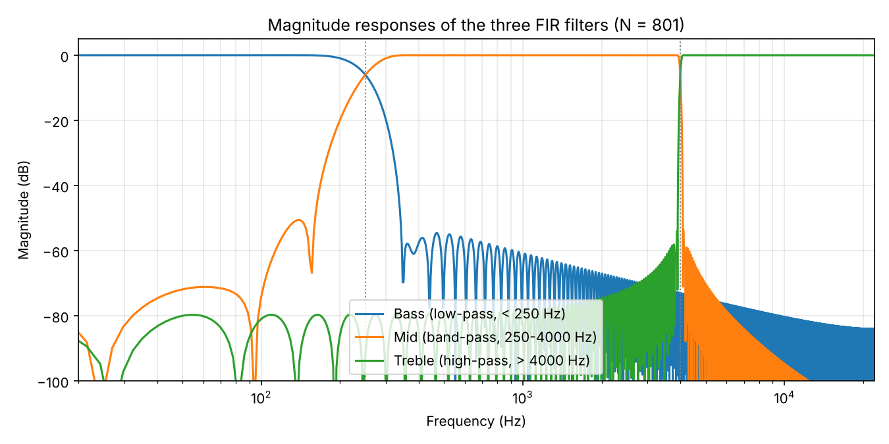
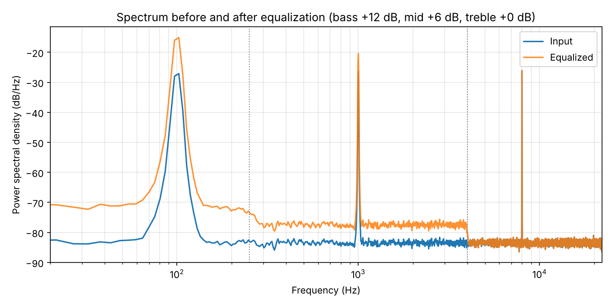
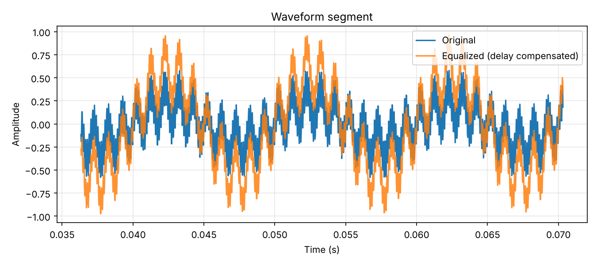

# Three-Band Digital Audio Equalizer with FIR Filters

A three-band audio equalizer in Python. The signal is split into bass, midrange and treble with linear-phase FIR filters, each band gets its own gain, and the bands are summed again.

Individual project for the course *Digital Signal Processing*, University of Padova.

## Design

| Band | Range | Filter |
|---|---|---|
| Bass | below 250 Hz | low-pass |
| Midrange | 250 Hz to 4000 Hz | band-pass |
| Treble | above 4000 Hz | high-pass |

- **Filters:** FIR, designed with the window method (`scipy.signal.firwin`, Hamming window), 801 taps each.
- **Phase:** the filters are symmetric, so they have linear phase and the same delay in every band, (N − 1) / 2 = 400 samples (9.07 ms at 44.1 kHz). The output is delayed but the bands stay aligned.
- **Gains:** set in dB per band and converted to linear scale.
- **Output:** normalized to a peak of 0.99 to avoid clipping, then saved as 16-bit WAV.



## Results

The notebook checks the equalizer in two ways.

**1. The bands add up to the original signal.** With all gains at 0 dB, the sum of the three filters deviates from a flat response by at most 0.005 dB between 20 Hz and 20 kHz.

**2. Each band gets the gain that was set.** The test signal has one tone in each band (100 Hz, 1000 Hz, 8000 Hz) plus low-level white noise. With bass +12 dB, mid +6 dB and treble 0 dB:

| Tone | Band | Set gain | Measured gain |
|---|---|---|---|
| 100 Hz | bass | +12.0 dB | +12.00 dB |
| 1000 Hz | mid | +6.0 dB | +6.01 dB |
| 8000 Hz | treble | 0.0 dB | 0.00 dB |



The noise floor shows the band edges: it is raised by 12 dB below 250 Hz, by 6 dB between 250 Hz and 4000 Hz, and unchanged above 4000 Hz.



## Limitation

The transition between bass and midrange is not sharp. With 801 taps at 44.1 kHz, the transition band of the filters is roughly 180 Hz wide, which is large compared with the 250 Hz edge. A sharper split at low frequencies would need longer filters, with a longer delay.

## Running the notebook

```
pip install -r requirements.txt
jupyter notebook equalizer.ipynb
```

To equalize your own audio, put a file named `input.wav` next to the notebook. Without it, the notebook generates the test signal described above (`test_signal.wav`).

## Files

```
equalizer.ipynb          the notebook, with outputs
figures/                 the figures shown above
test_signal.wav          generated test signal
equalized_output.wav     equalized test signal
```

## Note on the band edges

The version of this project presented in the course used a narrower midrange band (250 Hz to 1000 Hz) and a treble edge at 22 kHz, which left the range from 1 kHz to 22 kHz out of the output. This repository uses the band edges of the original design (250 Hz and 4000 Hz), so the three bands cover the whole spectrum.
